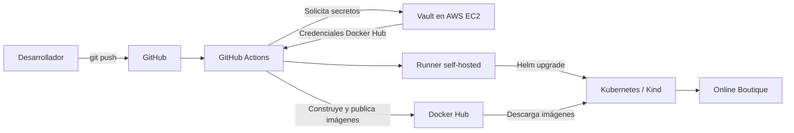

# Online Boutique - Proyecto Integrador DevOps

Implementación de prácticas DevOps sobre la aplicación **Online Boutique**, integrando infraestructura como código, integración y despliegue continuo, Kubernetes, Helm, Ansible y Vault para automatizar el despliegue y mejorar la administración de configuración y secretos.

---

## El problema

Online Boutique es una aplicación basada en microservicios que requiere diferentes procesos para construir imágenes, publicar contenedores, desplegar servicios y administrar información sensible.

Realizar estos procesos manualmente incrementa el riesgo de errores, configuraciones inconsistentes y exposición de credenciales. Además, cada actualización de la aplicación puede requerir repetir diferentes tareas de construcción y despliegue.

El objetivo del proyecto fue aplicar una metodología DevOps para automatizar estos procesos y crear un flujo de trabajo más reproducible, organizado y seguro.

---

## La propuesta

Durante la Fase I se propuso implementar un flujo DevOps para automatizar la infraestructura, construcción, publicación y despliegue de los microservicios de Online Boutique.

La solución utiliza:

- **Terraform** para administrar infraestructura como código.
- **Docker** para construir las imágenes de los microservicios.
- **Docker Hub** para almacenar las imágenes.
- **GitHub Actions** para automatizar procesos de CI/CD.
- **Kubernetes** para ejecutar la aplicación.
- **Helm** para administrar el despliegue.
- **Ansible** para automatizar la configuración del servidor Vault.
- **HashiCorp Vault** para administrar secretos.
- **AWS EC2** para ejecutar Vault fuera del clúster.
- **Git y GitHub** para control de versiones.
- **Trello** para planeación y seguimiento del proyecto.

La propuesta busca reducir tareas manuales, mejorar la seguridad de las credenciales y mantener un proceso de despliegue consistente.

---

## Arquitectura



Vault se ejecuta fuera del clúster de Kubernetes en una instancia EC2 de AWS. Su función es almacenar las credenciales utilizadas por el pipeline y limitar su acceso mediante políticas.

El despliegue de la aplicación se realiza mediante Helm sobre un clúster Kubernetes local.

---

## Tecnologías usadas

- Git
- GitHub
- GitHub Actions
- Docker
- Docker Hub
- Kubernetes
- Kind
- kubectl
- Helm
- Terraform
- AWS EC2
- Ansible
- HashiCorp Vault
- WSL / Ubuntu
- Trello

---

# Cómo funciona

## Infraestructura con Terraform

Terraform se utiliza para administrar infraestructura mediante código.

Durante la Fase III se utilizó Terraform para crear la infraestructura necesaria para ejecutar Vault en AWS.

Los recursos principales incluyen:

- Instancia EC2.
- Security Group.
- Regla de acceso SSH.
- Regla de acceso al puerto `8200`.
- Key Pair para la conexión SSH.
- Disco para almacenamiento de Vault.

Para inicializar Terraform:

```bash
cd terraform_fase3

terraform init
terraform validate
terraform plan
terraform apply
```

Los datos de la instancia se pueden consultar con:

```bash
terraform output
```

Debido a que AWS Academy utiliza laboratorios temporales, la IP pública de la instancia puede cambiar después de apagar y volver a iniciar el laboratorio.

Para actualizar el estado de Terraform se utiliza:

```bash
terraform apply -refresh-only
```

Después:

```bash
terraform output
```

permite consultar nuevamente la dirección actual del servidor Vault.

---

## Pipeline CI/CD con GitHub Actions y Helm

GitHub Actions se utiliza para automatizar procesos relacionados con integración y despliegue continuo.

El flujo utilizado en el proyecto es:

```text
Cambio en código
      ↓
Git Push
      ↓
GitHub Actions
      ↓
Vault
      ↓
Credenciales de Docker Hub
      ↓
Construcción de imágenes
      ↓
Docker Hub
      ↓
Runner self-hosted
      ↓
Helm
      ↓
Kubernetes
      ↓
Online Boutique
```

Online Boutique utiliza diferentes microservicios que deben ser construidos y desplegados de manera coordinada.

El pipeline de integración continua se encarga de automatizar la construcción de las imágenes.

Posteriormente, Helm se utiliza para aplicar la configuración de la aplicación sobre Kubernetes.

Ejemplo:

```bash
helm upgrade --install online-boutique ./helm-chart
```

El estado de los pods puede verificarse con:

```bash
kubectl get pods
```

Y los servicios con:

```bash
kubectl get services
```

---

## Configuración con Ansible

Ansible se utilizó para automatizar la instalación y configuración del servidor Vault.

La estructura principal utilizada fue:

```text
ansible/
├── group_vars/
│   └── vault.yml
├── politicas/
│   ├── admin.hcl
│   └── ci-readonly.hcl
├── templates/
│   └── vault.hcl.j2
├── instalar-vault.yml
└── inventario-aws.ini
```

El playbook se ejecuta con:

```bash
ansible-playbook -i ansible/inventario-aws.ini ansible/instalar-vault.yml
```

La primera ejecución realiza los cambios necesarios para instalar y configurar Vault.

Posteriormente se ejecutó nuevamente el mismo playbook para comprobar la **idempotencia**.

La segunda ejecución obtuvo:

```text
changed=0
```

Esto demuestra que Ansible detecta que la configuración ya se encuentra aplicada y evita realizar cambios innecesarios.

---

## Configuración y secretos con Vault

Vault se ejecuta fuera del clúster Kubernetes en una instancia EC2.

El servidor utiliza almacenamiento en disco y tiene habilitada su interfaz web.

Después de iniciar Vault se configuraron:

- 3 llaves de desellado.
- Umbral de 2 llaves.
- Motor de secretos KV v2.
- Política de acceso para CI/CD.
- Token específico para el pipeline.
- Tiempo de vida limitado para el token.

Después de reiniciar la instancia EC2, Vault vuelve a quedar sellado.

Primero se configura la dirección:

```bash
export VAULT_ADDR=http://IP_PUBLICA_EC2:8200
```

Después se comprueba su estado:

```bash
vault status
```

Si aparece:

```text
Sealed true
```

es necesario desellarlo:

```bash
vault operator unseal
```

Después de utilizar dos llaves válidas:

```text
Initialized    true
Sealed         false
Storage Type   file
```

---

## KV Secret Engine

Se configuró un motor de secretos KV versión 2:

```bash
vault secrets enable -path=secret kv-v2
```

Las credenciales utilizadas para Docker Hub se almacenan en la ruta:

```text
secret/online-boutique/dockerhub
```

Esto permite que las credenciales no tengan que almacenarse directamente dentro de los archivos del proyecto.

---

## Política de mínimo privilegio

Se creó una política específica para el pipeline:

```hcl
path "secret/data/online-boutique/*" {
  capabilities = ["read"]
}
```

Esta política permite únicamente operaciones de lectura sobre los secretos necesarios para Online Boutique.

El token utilizado por GitHub Actions no tiene permisos administrativos.

Para comprobarlo se realizaron intentos de escritura y acceso a rutas no autorizadas.

Vault respondió:

```text
403 permission denied
```

Esto demuestra la aplicación del principio de **mínimo privilegio**.

---

## Integración de Vault con GitHub Actions

GitHub Actions utiliza Vault para solicitar las credenciales necesarias para Docker Hub.

El flujo utiliza `hashicorp/vault-action`.

Ejemplo:

```yaml
- name: Leer credenciales de Docker Hub desde Vault
  uses: hashicorp/vault-action@v3
  with:
    url: ${{ vars.VAULT_ADDR }}
    token: ${{ secrets.VAULT_TOKEN }}
    secrets: |
      secret/data/online-boutique/dockerhub username | DOCKERHUB_USERNAME ;
      secret/data/online-boutique/dockerhub token | DOCKERHUB_TOKEN
```

La dirección del servidor se configura en GitHub como variable:

```text
VAULT_ADDR
```

El token utilizado por el pipeline se almacena como secreto:

```text
VAULT_TOKEN
```

Con esto se evita escribir directamente las credenciales reales dentro del workflow.

---

# Cómo levantar el proyecto

## 1. Clonar el repositorio

```bash
git clone https://github.com/AlanKenway4/Proyecto_Integrador_DevOps.git
```

Entrar al proyecto:

```bash
cd Proyecto_Integrador_DevOps
```

---

## 2. Verificar Kubernetes

```bash
kubectl cluster-info
kubectl get nodes
```

---

## 3. Crear o actualizar la infraestructura de Vault

```bash
cd terraform_fase3
terraform init
terraform apply
```

Consultar la IP:

```bash
terraform output
```

Si la instancia ya existe pero cambió su IP:

```bash
terraform apply -refresh-only
terraform output
```

---

## 4. Configurar Vault con Ansible

Desde la raíz del proyecto:

```bash
ansible-playbook -i ansible/inventario-aws.ini ansible/instalar-vault.yml
```

Para comprobar idempotencia se puede ejecutar nuevamente el mismo comando.

El resultado esperado es:

```text
changed=0
```

---

## 5. Configurar la dirección de Vault

```bash
export VAULT_ADDR=http://IP_PUBLICA_EC2:8200
```

---

## 6. Comprobar Vault

```bash
vault status
```

Si está sellado:

```bash
vault operator unseal
```

Se deben proporcionar al menos dos llaves válidas.

Después:

```bash
vault status
```

Debe indicar:

```text
Initialized    true
Sealed         false
```

---

## 7. Configurar GitHub

En el repositorio:

```text
Settings
→ Secrets and variables
→ Actions
```

Configurar la variable:

```text
VAULT_ADDR
```

con la dirección actual del servidor Vault.

También debe existir el secreto:

```text
VAULT_TOKEN
```

---

## 8. Ejecutar GitHub Actions

Desde GitHub:

```text
Actions
→ Fase III - Vault Demo
→ Run workflow
```

El workflow se comunica con Vault para solicitar las credenciales configuradas.

---

## 9. Desplegar con Helm

Ejecutar:

```bash
helm upgrade --install online-boutique ./helm-chart
```

Comprobar los pods:

```bash
kubectl get pods
```

Comprobar los servicios:

```bash
kubectl get services
```

Finalmente se accede al frontend de Online Boutique desde el navegador.

---

# Resultados

Durante el desarrollo del proyecto se obtuvieron los siguientes resultados:

- Uso de Terraform para administrar infraestructura.
- Implementación de Kubernetes para ejecutar Online Boutique.
- Automatización de procesos mediante GitHub Actions.
- Uso de Helm para administrar el despliegue.
- Configuración automatizada de Vault mediante Ansible.
- Evidencia de idempotencia de Ansible con `changed=0`.
- Vault ejecutándose fuera del clúster Kubernetes.
- Vault instalado sobre AWS EC2.
- Vault inicializado y desellado.
- Almacenamiento en disco configurado.
- Interfaz web de Vault habilitada.
- Motor KV v2 habilitado.
- Credenciales de Docker Hub almacenadas en Vault.
- Política de solo lectura para CI/CD.
- Token independiente para el pipeline.
- Comprobación del principio de mínimo privilegio mediante errores `403`.
- Comunicación entre GitHub Actions y Vault.
- Despliegue de Online Boutique mediante Kubernetes y Helm.

---

# Retos y lecciones aprendidas

## Credenciales temporales de AWS

AWS Academy utiliza credenciales temporales.

Cuando estas credenciales expiran, Terraform y AWS CLI dejan de poder comunicarse con AWS.

La solución consiste en obtener nuevas credenciales del laboratorio y actualizar:

```text
~/.aws/credentials
```

---

## Cambio de IP pública de EC2

Después de apagar y volver a iniciar el laboratorio, la instancia EC2 puede recibir una nueva IP pública.

Terraform puede conservar temporalmente la dirección anterior en su estado.

Para actualizarla se utiliza:

```bash
terraform apply -refresh-only
```

Después:

```bash
terraform output
```

permite consultar la nueva dirección.

También es necesario actualizar la variable:

```text
VAULT_ADDR
```

en GitHub.

---

## Vault sellado después de reiniciar EC2

Después de reiniciar la instancia, Vault vuelve a:

```text
Sealed true
```

Para recuperar el servicio fue necesario utilizar dos de las tres llaves de desellado.

Después:

```text
Sealed false
```

---

## Error de configuración inicial de Vault

Durante una de las primeras ejecuciones se generó un valor booleano incorrecto dentro de la configuración de Vault.

Esto provocó que el servicio no pudiera iniciar correctamente.

Después de corregir el template de Ansible, Vault pudo ejecutarse correctamente.

---

## Idempotencia de Ansible

La primera ejecución del playbook realizó los cambios necesarios.

Posteriormente se ejecutó nuevamente.

El resultado:

```text
changed=0
```

demostró que Ansible no realiza modificaciones innecesarias cuando el servidor ya está configurado.

---

## Permisos del token de Vault

Fue necesario comprobar que el token utilizado por GitHub Actions no tuviera permisos administrativos.

Al intentar escribir secretos o acceder a rutas no autorizadas, Vault devolvió:

```text
403 permission denied
```

Esto permitió comprobar que la política de mínimo privilegio estaba funcionando.

---

## LoadBalancer en Kubernetes local

Durante la Fase II algunos recursos permanecían pendientes porque la configuración utilizaba un servicio `LoadBalancer`.

En un clúster Kubernetes local este comportamiento provocaba problemas con el frontend.

Se modificó la configuración de Helm para utilizar una opción compatible con el entorno local y permitir que los pods pudieran ejecutarse correctamente.

---

## Integración de Vault con GitHub Actions

Durante las pruebas se confirmó que GitHub Actions podía comunicarse con Vault y solicitar las credenciales almacenadas.

También se detectó un problema posterior en el paso de autenticación con Docker Hub relacionado con la forma en que el token obtenido desde Vault era entregado al paso de login.

Este problema permitió identificar la importancia del correcto mapeo de variables y secretos entre acciones dentro de un workflow.

---

# Conclusión

El proyecto permitió integrar diferentes herramientas utilizadas dentro de un ciclo DevOps.

Terraform permitió administrar infraestructura mediante código. GitHub Actions permitió automatizar procesos de integración y despliegue. Kubernetes y Helm permitieron administrar los microservicios de Online Boutique. Ansible permitió automatizar la configuración del servidor y Vault permitió separar las credenciales sensibles del código fuente.

También se comprobó la importancia de la idempotencia, el principio de mínimo privilegio, la administración correcta de secretos y la automatización de tareas repetitivas.

Como mejoras futuras se podrían implementar:

- TLS para Vault.
- Auto Unseal.
- AppRole u OIDC en lugar de tokens estáticos.
- Kubernetes administrado en la nube.
- Monitoreo y observabilidad del sistema.

---

## Autor

**Ángel Alain Velez Bello**

Proyecto Integrador de la Metodología DevOps
